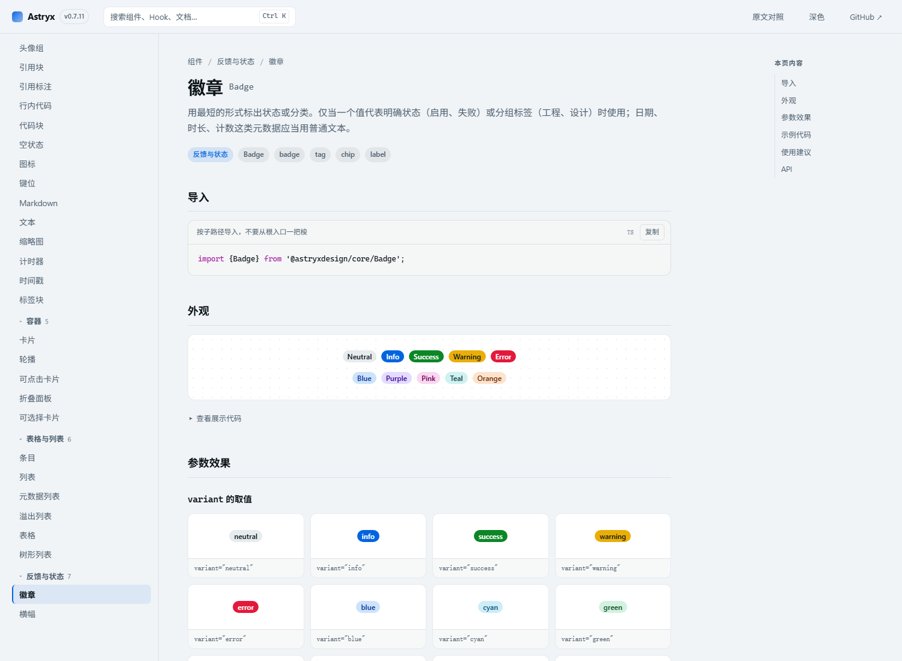
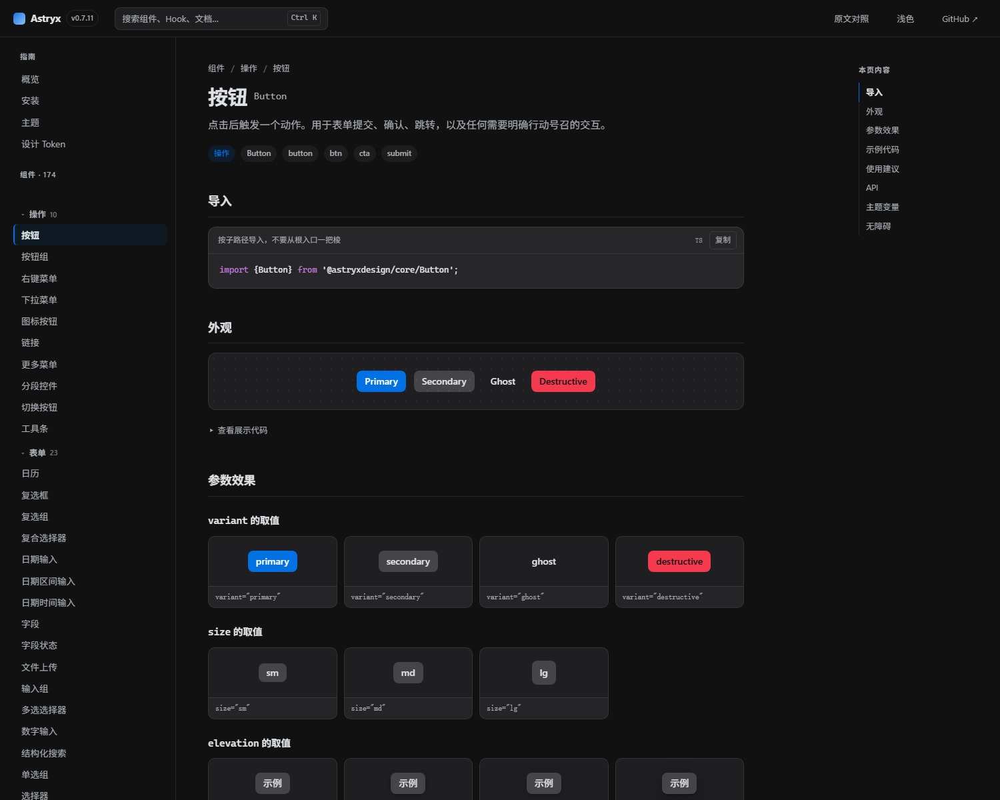
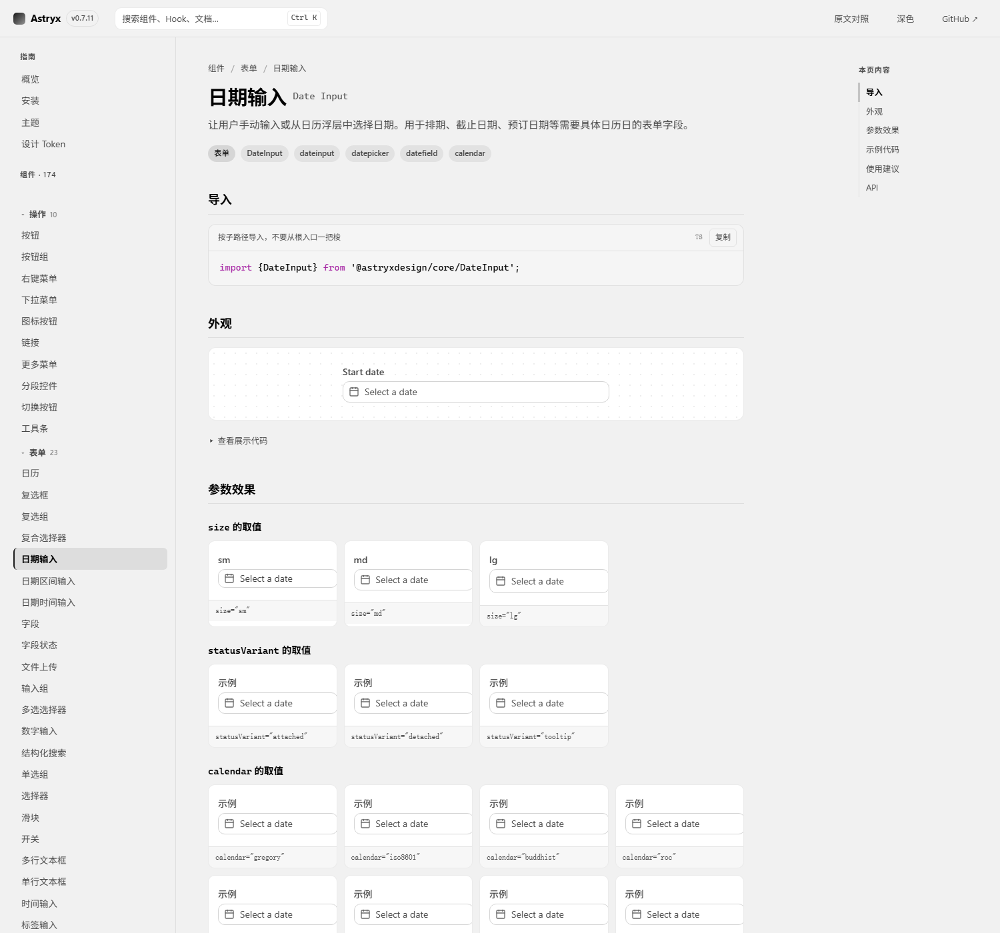

# Astryx 中文文档

> **非官方**中文文档站，为 [Meta Astryx](https://github.com/meta/astryx) 设计系统（`@astryxdesign/core` v0.7.11）构建。
> 官方文档为英文，本仓库提供完整简体中文翻译 + 可交互的组件预览。

**🔗 在线地址：<https://cmy0714.github.io/Astryx-Chinese-Docs/>**



## 这是什么

一个**纯静态、无构建步骤、可离线运行**的组件文档站。打开 `index.html`（需经 HTTP 服务）即可浏览 174 个组件的：

- **中文说明** —— 每个组件的用途、使用建议（Do / Don't）、API 参数说明、无障碍要求，全部中文
- **可交互预览** —— 真实挂载的 React 组件，日期选择器、下拉、弹窗、提示都能点开
- **参数效果网格** —— 每个枚举型参数逐值渲染，一眼看出 `variant="primary"` 和 `"ghost"` 差在哪
- **中英文搜索** —— `Ctrl K`，输入「徽章」「气泡」或 `badge` 都能命中
- **深浅色** —— 跟随系统或手动切换，预览与文档chrome 同步

| 深色模式 | 日期输入 |
|---|---|
|  |  |

## 翻译覆盖度

由 `zh-status.mjs` 逐组件校验，当前状态：

| 项目 | 覆盖 | 数量 |
|---|---|---|
| 组件中文名 | 100% | 174 / 174 |
| 组件说明 | 100% | 174 / 174 |
| 使用建议（Do / Don't） | 100% | 722 / 722 |
| API 参数说明 | 100% | 2033 / 2033 |

翻译按批次维护在 `zh-batch-NN.json`（共 29 批），`merge-zh.mjs` 深合并进 `zh.json`，便于单条修订与回溯。

## 快速开始

直接访问在线版：<https://cmy0714.github.io/Astryx-Chinese-Docs/>

本地运行：

```bash
# 任选一种静态服务器
python -m http.server 8125
# 或
npx serve -l 8125

# 打开 http://127.0.0.1:8125
```

> 必须经 HTTP 访问：`live.js` 是打包后的 IIFE bundle，`file://` 下部分浏览器会拦截脚本加载。

### 部署到 GitHub Pages

仓库已配置 Pages（`main` 分支根目录 + `.nojekyll`）。推送到 `main` 后自动构建，几分钟内生效。

## 目录结构

```
├── index.html            单页外壳
├── styles.css            文档站样式（基于 Astryx design token）
├── app.js                路由、搜索、目录、预览挂载
├── live.js               可交互预览 bundle（esbuild 产物，约 2.2MB）
│
├── data.json             从 astryx CLI 导出的组件元数据（174 个组件）
├── previews.json         构建时 SSR 出的静态 HTML（作为 live.js 的降级保底）
│
├── zh.json               全部中文条目（合并结果，唯一事实源）
├── zh-batch-01..29.json  分批翻译原始文件
├── meta.json             版本信息
│
├── build-data.mjs        ① 调 CLI 导出元数据
├── build-previews.mjs    ② SSR 渲染出静态 HTML
├── build-live.mjs        ③ 打包可交互预览
├── merge-zh.mjs          合并中文批次
├── zh-status.mjs         校验翻译覆盖率（--todo 列出缺口）
├── check-live.mjs        无头浏览器验证预览是否挂载成功
└── diag-theme.mjs        检查 <html> 主题属性是否被污染
```

## 数据流水线

内容全部来自 Astryx 官方 CLI 与包内元数据，**不依赖模型记忆**：

```bash
# 1. 从 CLI 导出组件元数据（需要全局安装 @astryxdesign/cli）
node build-data.mjs

# 2. 构建时 SSR：把每个 showcase 渲染成静态 HTML（需 astryx CLI + 本地依赖）
node build-previews.mjs

# 3. 打包可交互预览（需要 react/react-dom/@astryxdesign/core 等）
node build-live.mjs

# 4. 合并中文批次并校验覆盖率
node merge-zh.mjs
node zh-status.mjs
```

前两步依赖 `astryx` CLI 与 Astryx 包本体；第 3 步依赖 `package.json` 里的开发依赖。

## 设计说明

### 为什么预览要两套产物

- `previews.json`（SSR 静态 HTML）在 `live.js` 加载失败时兜底，保证不白屏
- `live.js` 挂载后由 React 完全接管，组件才有状态与事件

### 主题隔离（重要）

早期版本给每个预览套了 `<Theme>`，而 Astryx 的「根 Theme」会把 `data-theme` / `data-astryx-theme` 写到 `<html>` 上，**导致连续翻页后整个站点主题被预览覆盖**（表现为配色失效、变灰）。

现在预览**不套 Theme**：文档站已在 `<html>` 加载同一套 token CSS，组件直接使用全局 CSS 变量，既跟随站点明暗切换，也不会污染全局属性。回归可用 `node diag-theme.mjs` 检查——正常时 `<html>` 上不应出现 `data-astryx-theme`。

## 已知限制

- **非官方翻译**：Astryx CLI 的 `--zh` 对组件不生效（实测仍返回英文），本仓库中文为人工翻译，可能与后续官方译文不一致
- **趋势性风险**：Astryx 处于 Beta，`0.x` 版本接口会变；升级后需重跑上面四步
- **可交互预览的覆盖**：156 个组件有 showcase，551 个参数变体；Provider / Hook 类组件无独立外观
- **依赖浏览器能力**：深色模式、`color-mix()`、容器查询等需要较新的浏览器

## 联系与支持

有问题、想提改进，或者要交流 Astryx 的用法，扫码加微信：


如果这份中文文档帮你省了时间，可以请作者喝杯咖啡（微信赞赏码）：


## 许可证与致谢

- **Astryx** 版权归 Meta Platforms, Inc.，以 MIT 许可证开源：<https://github.com/meta/astryx>
- 本仓库的**站点代码与中文翻译**同样以 MIT 发布（可按需修改）
- 组件元数据、showcase 源码均来自 `@astryxdesign/core` 与 `@astryxdesign/cli` 的公开产物
